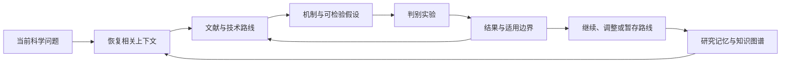

<div align="center">

# Ariadne

### Scientific Research Harness for Codex

**让研究上下文、证据与决策，沿着项目持续积累。**

[快速开始](#快速开始) · [科研工作方式](#科研工作方式) · [知识与记忆](#知识与记忆) · [命令速查](#命令速查)


</div>

---

Ariadne 是安装在科研项目中的 **Codex Harness**。它通过 `AGENTS.md`、研究 Skills、可选 Hooks、Research State 和本地知识库，把文献阅读、机制分析、假设提出、实验设计与跨会话恢复连接起来。

你继续在 Codex 中提出问题、阅读论文、编写代码和开展实验。Ariadne 将重要的研究进展整理为项目中的持久上下文，让下一次研究能够接上已有证据、未决问题和技术路线。

> **核心设计：围绕当前科学问题组织上下文，围绕证据变化更新研究决策。**

## 为什么选择 Ariadne

| 能力 | 在科研中如何使用 |
| --- | --- |
| **任务相关的上下文** | 按研究意图、焦点和字符预算恢复问题、条件、相关结果与未决决策。 |
| **文献驱动的研究工作流** | 从问题出发整理技术路线，按需阅读来源和章节，把关键发现连回出处。 |
| **带证据的知识图谱** | 连接问题、方法、技术、机制、实验、结果与限制，同时保留适用条件和证据角色。 |
| **跨领域机制迁移** | 分开记录来源结果、迁移假设、目标命题和目标证据，形成可检验的技术桥接。 |
| **持续研究记忆** | 保存结论、反例、替代解释、路线选择和重新考虑路线的触发条件。 |
| **可检查的研究写回** | 用原子事务提交研究记忆，支持预检查、依赖基线、修订关系与写回回执。 |
| **轻量本地存储** | SQLite 管理图谱和状态，FTS 支持词法检索，sqlite-vec 与可选 FastEmbed 提供向量检索。 |

## 快速开始

准备 Python **3.10+** 和可用的 Codex 环境。

### 1. 安装

```bash
git clone https://github.com/WAWSE/Ariadne.git
cd Ariadne
python -m pip install -e .
```

安装后的命令名为 `srh`，Python 包名为 `research_harness`。

### 2. 初始化你的科研项目

在 Ariadne 源码目录之外，选择你的实际科研项目：

```bash
srh init ../my-research --question "我的研究问题是什么？"
```

初始化会生成项目指令、五个研究 Skills、本地知识库和项目运行入口。已有的用户指令和自定义 Skill 内容会得到保留。

### 3. 在 Codex 中开始研究

在 `my-research` 目录中打开 Codex，用自然语言描述任务，例如：

```text
围绕这个研究问题，整理主要技术路线和代表性论文。
重点比较各路线的作用机制、适用条件、关键证据与尚未解决的问题。
保存会影响后续实验选择的研究记忆。
```

后续会话可以直接继续：

```text
恢复这个项目的研究上下文。
结合新增结果，比较当前路线与备选路线，提出最有区分力的下一项实验。
```

也可以手动恢复项目简报：

**Windows PowerShell**

```powershell
cd ..\my-research
.\.research\srh.cmd context
```

**macOS / Linux**

```bash
cd ../my-research
./.research/srh context
```

项目运行入口绑定初始化时的 Python 环境，可从项目中直接调用。

## 科研工作方式

Ariadne 按当前问题选择合适的研究动作：领域梳理、定向阅读、机制迁移、判别实验、结果分析或记忆写回。



### 按决策价值推进研究

- **方向探索**：梳理主要路线、竞争解释与关键不确定性，选择能够较快检验方向的实验。
- **机制定位**：围绕有价值的结果安排消融、控制变量、复现和失败案例分析。
- **证据更新**：将新结果绑定到测量对象与实验条件，重新比较相关路线。
- **跨会话接续**：保存能重建未决比较的最小完整记忆，保留来源、条件、备选方案和下一步依据。

Codex 使用当前会话中可用的搜索、浏览、文档阅读和执行工具完成研究；Ariadne 提供项目级的工作方式与持久记忆层。模型调用沿用你的 Codex 配置。

## 五个研究 Skills

| Skill | 作用 |
| --- | --- |
| [`srh-research-map`](src/research_harness/templates/skills/srh-research-map/SKILL.md) | 将问题映射为技术路线、检索方向、证据缺口与反证线索。 |
| [`srh-paper-read`](src/research_harness/templates/skills/srh-paper-read/SKILL.md) | 按来源与章节阅读，区分作者报告、机制解释和实际观测。 |
| [`srh-hypothesis-bridge`](src/research_harness/templates/skills/srh-hypothesis-bridge/SKILL.md) | 构造来源域到目标域的条件化迁移假设与判别性测试。 |
| [`srh-experiment`](src/research_harness/templates/skills/srh-experiment/SKILL.md) | 设计有预算的实验，明确预测、替代解释、指标与结果对路线的影响。 |
| [`srh-checkpoint`](src/research_harness/templates/skills/srh-checkpoint/SKILL.md) | 恢复上下文，写回重要学习、证据、决策和研究状态。 |

Skills 按任务需要使用。普通续研从简报开始；当缺少某个会改变判断的字段时，再读取对应记录或关系路径。

## 知识与记忆

### 从论文走向研究关系

Ariadne 将知识组织为可追溯的记录与关系：

```text
问题 → 方法 → 技术 → 作用机制
                    ↓
                假设 → 实验 → 结果
                    ↘ 证据、限制、反例与决策
```

记录类型覆盖论文、来源、问题、方法、技术、机制、命题、证据、假设、实验、结果、限制、决策与检索过程。关系包括引用、使用、支持、反驳、限制、类比、测试、派生与修订。

每条重要研究信息都可以携带：

- **来源锚点**：论文、资料或实验记录。
- **定位信息**：章节、段落、表格、文件位置或结果工件。
- **证据类别**：作者报告、作者解释、本地观测或计划。
- **断言相对的角色**：支持、反证、背景、类比或尚不确定。
- **适用范围**：来源域、目标域、任务与实验条件。
- **依赖关系**：保存引用内容的基线，便于在上游材料变化后定位需要复核的判断。

这样，跨领域探索可以沿着“相似问题 → 候选机制 → 来源证据 → 目标条件 → 验证实验”展开。

### 三种互补的记忆

| 层次 | 内容 | 主要入口 |
| --- | --- | --- |
| **Research State** | 当前问题、活跃假设、未解决事项和下一步 | `state`、`context` |
| **研究交接** | 当前比较、来源覆盖情况、重要细节与待办 | `.research/handoff.md` |
| **结构化知识** | 来源、证据、命题、实验、决策及其关系 | `remember`、`show`、`graph` |

`context` 根据当前任务构造有界简报；`show` 支持一次读取多个明确记录；`remember` 将需要长期保留的变化原子写入知识库。

### 预测与迁移敏感性

`forecast-update` 提供一个专门的预测写回回执：分别记录基线、目标工件、证据范围与条件敏感性，并校验文件哈希。

```bash
srh forecast-update --template
srh forecast-update --check receipt.json
srh forecast-update receipt.json
```

回执提交到 `.research/forecast-updates/`。在声明估计对象不匹配的条件敏感性路径中，校验要求目标与基线工件保持一致，敏感性结果另存，从而保留预测与迁移场景各自的身份。

## 项目结构

初始化后的科研项目：

```text
my-research/
├── AGENTS.md                        # Codex 的项目级研究入口
├── .agents/skills/
│   ├── srh-research-map/
│   ├── srh-paper-read/
│   ├── srh-hypothesis-bridge/
│   ├── srh-experiment/
│   └── srh-checkpoint/
├── .research/
│   ├── knowledge.sqlite3            # 图谱、证据、状态与检索数据
│   ├── srh.cmd / srh                # 当前系统对应的项目运行入口
│   ├── harness-assets.json          # 安装资源清单
│   ├── handoff.md                   # 按需创建的研究交接
│   ├── forecast-updates/            # 按需提交的预测回执
│   └── exports/                     # 检查点与导出快照
└── .codex/hooks.json                # 使用 --hooks 时生成
```

### 可选 Hooks

```bash
srh init ../my-research --hooks
```

在 Codex 中完成项目 Hook 的信任配置后，SessionStart 可提供简短研究上下文，Stop 可刷新已保存研究状态的有界快照。Hook 处理器使用本地存储，保持启动和结束路径轻量。

### 可选语义检索

在 Ariadne 源码目录安装语义检索依赖：

```bash
python -m pip install -e ".[semantic]"
```

然后为科研项目显式建立索引：

```bash
srh --project ../my-research index --provider fastembed
srh --project ../my-research search "representation disentanglement" --mode hybrid --limit 5
```

向量检索用于辅助召回；研究简报与日常记忆写回可直接使用本地结构化记录和词法检索。

## 可运行示例

仓库提供一个完整的合成研究例子，演示来源、反例、迁移假设与路线决策的恢复。在 Ariadne 源码目录执行：

```bash
srh init ../ariadne-example --question "哪些条件决定机制迁移是否成立？"
srh --project ../ariadne-example remember examples/workflow-remember-delta.json
srh --project ../ariadne-example state --file examples/workflow-context-state.json
srh --project ../ariadne-example context --intent bridge --focus hypothesis:workflow-transfer
srh --project ../ariadne-example show hypothesis:workflow-transfer evidence:workflow-source
```

也可以用自然语言让 Codex 沿着这份研究记忆继续：

```text
恢复当前迁移假设的来源与适用边界。
比较已有支持与反例，设计一个能区分机制解释和备选解释的实验。
将影响下一次判断的新信息写回研究记忆。
```

## 命令速查

| 任务 | 命令 |
| --- | --- |
| 初始化项目 | `srh init PATH --question "研究问题"` |
| 恢复简报 | `srh context` |
| 按任务恢复 | `srh context --intent bridge --focus ID --max-chars 3000` |
| 读取记录 | `srh show ID1 ID2` |
| 检索知识 | `srh search "关键词" --mode lexical` |
| 查看关系 | `srh graph ID --hops 1` |
| 记住研究变化 | `srh remember delta.json` |
| 预检查写回 | `srh remember --check delta.json` |
| 短格式写回 | `srh remember --compact memory.json` |
| 保存来源与证据 | `srh remember --evidence evidence.json` |
| 结果更新假设 | `srh remember --result-update update.json` |
| 生成写回模板 | `srh remember --compact-template transfer-hypothesis` |
| 检查预测回执 | `srh forecast-update --check receipt.json` |
| 读写研究状态 | `srh state` / `srh state --file state.json` |
| 检查记录维护信息 | `srh quality --focus ID` |
| 导出检查点 | `srh checkpoint --note "本轮研究进展"` |
| 导出知识库 | `srh export bundle.json` |
| 查看安装状态 | `srh doctor` |

`context --intent` 支持 `resume`、`map`、`read`、`bridge`、`experiment` 与 `analyze`。在项目外运行时，可以通过全局参数 `--project PATH` 指定项目。

## 开发

```bash
python -m pip install -e ".[dev]"
python -m pytest tests -q
```

源码按项目集成、上下文构造、数据语义、存储、检索和 CLI 分层；研究工作方式随包内 Skills 一同分发。

```text
src/research_harness/
├── project.py       # AGENTS、Skills、运行入口与 Hooks 装配
├── context.py       # 任务相关的有界研究上下文
├── models.py        # 记录与关系的数据结构
├── semantics.py     # 证据角色与适用范围
├── store.py         # SQLite、事务写回与研究状态
├── quality.py       # 来源依赖与记录维护检查
├── retrieval.py     # 词法与向量检索
├── embeddings.py    # 显式加载的向量提供者
├── cli.py           # srh 命令入口
└── templates/skills/# 五个研究 Skills 与写回参考
```

## 设计启发

Ariadne 借鉴 [Trellis](https://github.com/mindfold-ai/Trellis) 将工作方式、上下文和持久记忆带入项目的思路，围绕科学研究中的文献、机制、证据边界与实验决策构建自己的项目集成层。

---

<div align="center">

**Ariadne — 让每一轮研究，接上上一轮的线索。**

[GitHub](https://github.com/WAWSE/Ariadne) · [Issues](https://github.com/WAWSE/Ariadne/issues)

</div>
